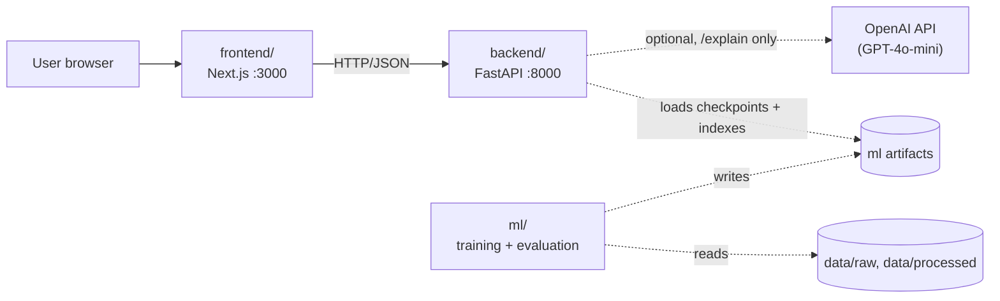
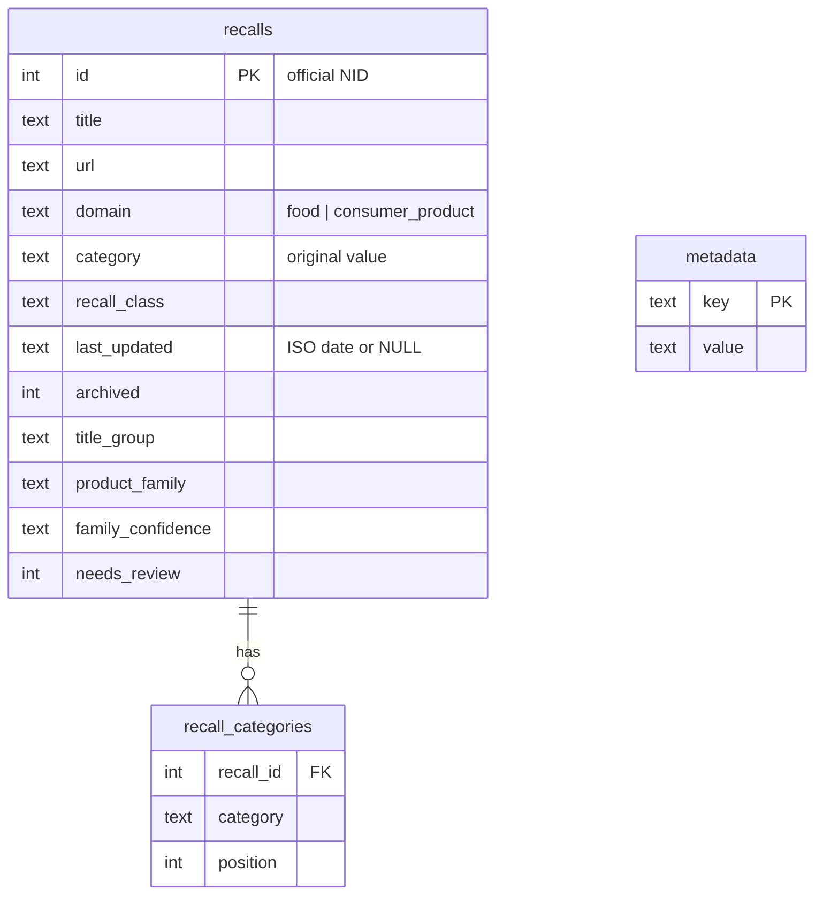

# RecallIQ — Architecture Notes

## Style: modular monorepo, two runtime services

RecallIQ is a small academic project built by one developer. The simplest defensible
architecture is one repository holding two independently runnable services plus offline
ML code:

| Component  | Responsibility                                                      | Runs when       |
| ---------- | ------------------------------------------------------------------- | --------------- |
| `frontend` | UI only. Calls the backend; holds no business logic or secrets.     | Online          |
| `backend`  | REST API, validation, serving model predictions.                    | Online          |
| `ml`       | Data cleaning, feature prep, training, evaluation. Produces artifacts. | Offline / batch |
| `data`     | Raw downloads and processed datasets (not committed to git).        | —               |

## Key decisions

**Why separate FastAPI instead of Next.js API routes?**
The deep-learning stack (PyTorch etc.) is Python. Serving models from a Python service
avoids a cross-language bridge. Cost: two dev servers and a CORS boundary.

**Why `ml/` separate from `backend/`?**
Training is offline and heavy; serving is online and should stay lean. The backend will
only *load* trained artifacts, which keeps train/test code out of the request path and
makes evaluation reproducible on its own.

**Why SQLite (Phase 1B)?**
The dataset is ~1,000 read-only records rebuilt from a CSV. SQLite is a single file,
needs no server, and the API opens it read-only (`mode=ro`). The pipeline rebuilds it
atomically (temp file + replace). Revisit if the app needs concurrent writes or
multi-user data.

**Why does `ml/` own the schema?**
The pipeline creates the database; the backend only reads it. Tests build a fixture DB
with the same pipeline code, so the API is always tested against the real schema.

**Configuration**
All runtime config comes from environment variables (`RECALLIQ_*` for the backend,
`NEXT_PUBLIC_*` for the browser). `.env.example` files document them; real `.env`
files are git-ignored.

## API surface (current)

| Method | Path | Response | Errors |
| --- | --- | --- | --- |
| GET | `/health` | `{"status":"ok","service","version","environment"}` | — |
| GET | `/recalls?limit=20&offset=0` | `{"items":[RecallSummary], "total", "limit", "offset"}` newest first | 422 bad paging, 503 no DB |
| GET | `/recalls/{id}` | `RecallDetail` (all fields incl. family + review flags) | 404, 422, 503 |
| GET | `/categories` | `{"items":[{"category","domain","count"}], "total"}` | 503 |
| POST | `/search` | `{"query","model","score_type","score_description","top_k","domain","category","results":[{"rank","recall_id","title","category","issue","url","score","domain","last_updated","archived"}], "identifiers_in_query", "identifier_checks":[{"recall_id","verdict","by_type"}], "notice"}` — `model` ∈ `bm25`, `minilm` (A), `minilm_finetuned` (B), `minilm_hard_negative` (C) | 422 invalid body / unknown model, 503 no DB / selected model's checkpoint or index unavailable or incompatible |
| GET | `/search/models` | `{"models":[{"model","available","score_type","description","reason"}]}` | 503 no DB |
| POST | `/explain` | `{"query","model","evidence_status","retrieved_facts":[…stored fields incl. "what_you_should_do", "identifier_verdict"…],"skipped_identifier_mismatches","explanation":{"generator","text","cited_recall_ids","fallback_reason","evidence_sufficient","generation":{"provider","model","outcome","prompt_version","latency_ms","prompt_tokens","completion_tokens","total_tokens"}},"sources":[official URLs],"disclaimer"}` (`top_k` ≤ 5, default `RECALLIQ_RAG_TOP_K`). OpenAI failures never change the status code: the template is returned with `fallback_reason` | as `/search` |

Phase 4 additions are **additive**: the original `/search` request and every original
response field are unchanged (existing tests pass unmodified).

**Fine-tuned models in the API.** Each of B and C = a checkpoint directory + an embedding
index built by that checkpoint (`python -m retrieval.finetuned`). The index's metadata
records the checkpoint's weights SHA-256; at load time the API refuses (503 with the reason)
an index whose weights hash, dimension, recall ids or corpus fingerprint do not match. Paths:
`RECALLIQ_MODEL_B_CHECKPOINT`, `RECALLIQ_MODEL_B_EMBEDDINGS_DIR`, `RECALLIQ_MODEL_C_CHECKPOINT`,
`RECALLIQ_MODEL_C_EMBEDDINGS_DIR` (defaults: `ml/artifacts/models/model-{b,c}-v1/checkpoints/best`,
`ml/artifacts/embeddings/model-{b,c}-v1`). A missing model only disables that model.
Scores: BM25 and cosine similarity are labelled by `score_type` and never compared.

**Identifier checks** (`ml/verification/identifiers.py`): exact, deterministic comparison of
UPC / model / lot / best-before codes in the query vs the indexed recall record; MATCH or
MISMATCH only when both sides list that identifier type, else UNKNOWN. **Explanations**
(`ml/rag/pipeline.py`): evidence = stored fields of the top results only; deterministic
template generator by default (no network, no key). With `RECALLIQ_LLM_PROVIDER=openai`
(`ml/rag/llm.py`, default model `gpt-4o-mini`) an AI answer is written from the same evidence
and shown only if it passes `ml/rag/guards.py` (grounded codes and ids, verbatim quotes, no
foreign URLs, no safety or unverified identifier claims). Errors, timeouts and rejected
answers fall back to the template with a `fallback_reason`. Latency and token usage are
returned in `explanation.generation`. See [`RAG.md`](RAG.md).

**Shared retrieval code.** `ml/retrieval` is installed in editable mode (`pip install -e
ml`) and imported by both the offline embedding script and the API, so documents and
queries are encoded by the same code and the same pinned model revision. See
[`RETRIEVAL.md`](RETRIEVAL.md).

## Data model (SQLite, `data/processed/recalliq.db`)

