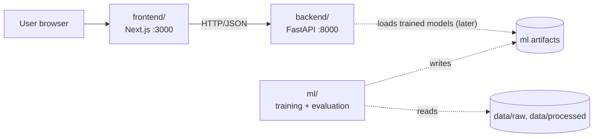
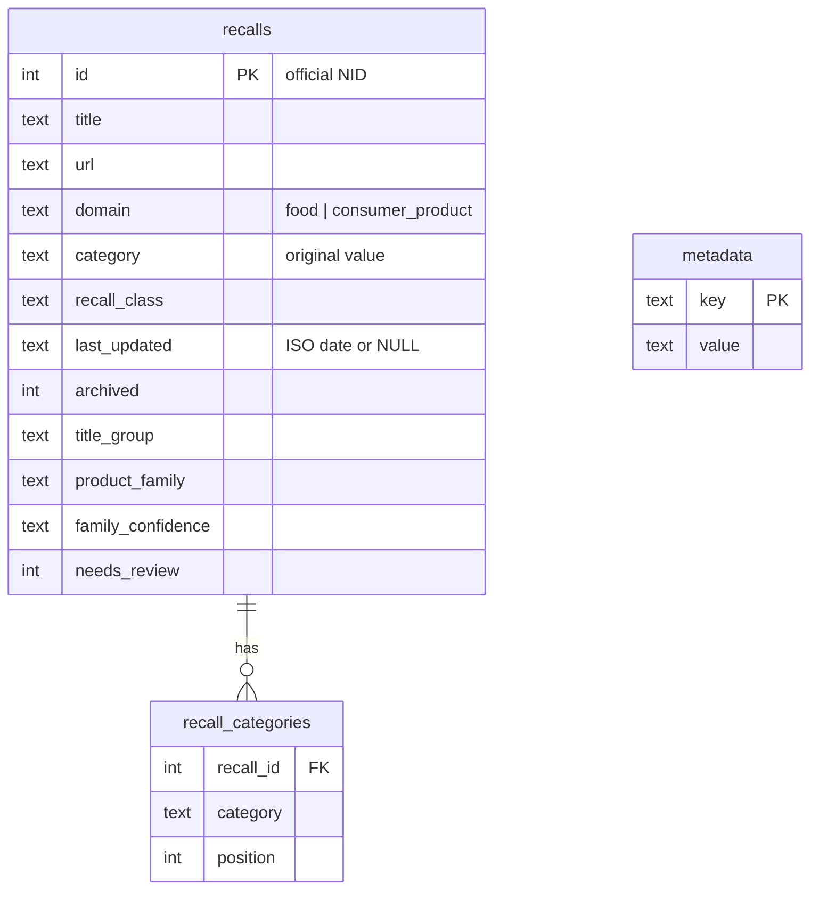

# RecallIQ — Architecture Notes

## Style: modular monorepo, two runtime services

RecallIQ is a small academic project built by one developer. The simplest defensible
architecture is one repository holding two independently runnable services plus offline
ML code:

| Component  | Responsibility                                                      | Runs when       |
| ---------- | ------------------------------------------------------------------- | --------------- |
| `frontend` | UI only. Calls the backend; holds no business logic or secrets.     | Online          |
| `backend`  | REST API, validation, serving model predictions.                    | Online          |
| `ml`       | Data cleaning, feature prep, training, evaluation. Produces artifacts. | Offline / batch |
| `data`     | Raw downloads and processed datasets (not committed to git).        | —               |

## Key decisions

**Why separate FastAPI instead of Next.js API routes?**
The deep-learning stack (PyTorch etc.) is Python. Serving models from a Python service
avoids a cross-language bridge. Cost: two dev servers and a CORS boundary.

**Why `ml/` separate from `backend/`?**
Training is offline and heavy; serving is online and should stay lean. The backend will
only *load* trained artifacts, which keeps train/test code out of the request path and
makes evaluation reproducible on its own.

**Why SQLite (Phase 1B)?**
The dataset is ~1,000 read-only records rebuilt from a CSV. SQLite is a single file,
needs no server, and the API opens it read-only (`mode=ro`). The pipeline rebuilds it
atomically (temp file + replace). Revisit if the app needs concurrent writes or
multi-user data.

**Why does `ml/` own the schema?**
The pipeline creates the database; the backend only reads it. Tests build a fixture DB
with the same pipeline code, so the API is always tested against the real schema.

**Configuration**
All runtime config comes from environment variables (`RECALLIQ_*` for the backend,
`NEXT_PUBLIC_*` for the browser). `.env.example` files document them; real `.env`
files are git-ignored.

## API surface (current)

| Method | Path | Response | Errors |
| --- | --- | --- | --- |
| GET | `/health` | `{"status":"ok","service","version","environment"}` | — |
| GET | `/recalls?limit=20&offset=0` | `{"items":[RecallSummary], "total", "limit", "offset"}` newest first | 422 bad paging, 503 no DB |
| GET | `/recalls/{id}` | `RecallDetail` (all fields incl. family + review flags) | 404, 422, 503 |
| GET | `/categories` | `{"items":[{"category","domain","count"}], "total"}` | 503 |

## Data model (SQLite, `data/processed/recalliq.db`)

