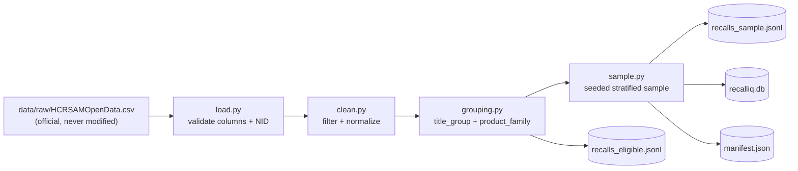

# RecallIQ — Data Pipeline (Phase 1B)

Code: `ml/recall_data/`. Entry point: `python -m recall_data.build` (run from `ml/`).

## Source

| Item | Value |
| --- | --- |
| Dataset | Government of Canada — Recalls and Safety Alerts open data (`HCRSAMOpenData.csv`) |
| Provided by | Project owner (downloaded file, not scraped) |
| SHA-256 | `30ad96831dd5d99cc16d63e94fb7ba43c558c464abab8ad73c62cd931aeae84d` |
| Encoding | UTF-8 with BOM, 11 columns, 34,384 rows, no ragged rows |
| Columns | `NID, Title, URL, Organization, Product, Issue, What you should do, Category, Recall class, Last updated, Archived` |

The pipeline records the input hash in `manifest.json` and in the SQLite `metadata`
table, so every output can be traced to the exact file it came from.

## 1. Loading (`load.py`)
- Every column is read as text (`dtype=str`, `keep_default_na=False`): pandas never guesses
  types or turns empty cells into NaN at this stage.
- Fails loudly if any expected column is missing, or if `NID` is non-numeric or duplicated.

## 2. Eligibility filter (`clean.py`)
Eligibility uses the dataset's own `Organization` values:

| Organization | Rows | Decision | RecallIQ `domain` |
| --- | ---: | --- | --- |
| CFIA | 5,348 | **kept** | `food` |
| Consumer product safety | 5,238 | **kept** | `consumer_product` |
| TC (Transport Canada) | 9,984 | excluded — vehicles | — |
| Medical devices | 8,726 | excluded | — |
| Drugs and health products | 1,948 | excluded | — |
| Communications and Public Affairs Branch | 1,814 | excluded — mixed feed, mostly drugs/health | — |
| Marketed health products | 1,162 | excluded | — |
| Controlled substances and cannabis | 102 | excluded | — |
| HC | 62 | excluded — drugs/devices | — |

*Trade-off:* the Communications branch feed contains ~150 food and ~50 consumer items,
but its categories are mixed with drugs; excluding the whole organization keeps the rule
simple and auditable.

## 3. Normalization (no fabrication)
| Field | Rule |
| --- | --- |
| All text | Remove zero-width spaces, NBSP → space, collapse/trim whitespace. Words, casing and punctuation are untouched. |
| Empty cells | → `null` |
| `Recall class` | Literal placeholder `--` → `null`; compound values (e.g. `Class 1 - Class 2`) kept as-is |
| `Last updated` | Strict ISO `yyyy-mm-dd`; unparseable → `null` (count reported in manifest) |
| `Archived` | `"1"`/`"0"` → `true`/`false`; any other value fails the run |
| `Category` | Original string kept in `category`; also split on `" - "` into `categories` list |

Preserved verbatim (after whitespace normalization): NID (`id`), title, URL, organization,
category, product, issue, "what you should do", recall class, archived flag.

## 4. Exact-title groups
`title_group = "tg_" + sha256(title)[:12]` over the whitespace-normalized, **case-sensitive**
title. Identical titles always get the same id, across runs and future data refreshes.
`title_group_size` counts eligible records sharing the title. This is *exact* duplication
only — near-duplicates are deliberately not merged.

## 5. Sampling strategy (`sample.py`)
1. **Deduplicate:** keep one record per `title_group` (latest `last_updated`, then highest id).
2. **Stratify** by `(domain, primary category)` — primary = first category in the cell.
3. **Allocate** the target (1,000) proportionally to stratum sizes using the
   largest-remainder method (ties broken by stratum name).
4. **Draw** within each stratum using `numpy.random.default_rng(seed)`; strata processed in
   sorted order, members sorted by id, so the result depends only on data + seed.

Default seed: **4110**. Re-running produces a byte-identical `recalls_sample.jsonl`
(verified). Per-stratum `available`/`selected` counts are in `manifest.json` → `strata`.

*Consequence:* the sample mirrors the deduplicated eligible pool, so CFIA's generic `Food`
category (the largest stratum) is ~36% of the sample. Small strata may receive 0 records.

## 6. Product families — initial, NOT ground truth
| Confidence | Source | Rule | `needs_review` |
| --- | --- | --- | --- |
| high | official_category | exactly one specific (non-generic) official category | false |
| medium | official_category | several specific official categories (first is used) | true |
| medium | keyword | generic category; exactly one keyword family matched | true |
| low | keyword / none | several families matched, or none | true (`product_family = null`) |

Generic categories: `Food`, `Other`, `Multiple food items`, `Consumer products`.
Keyword families reuse the dataset's own category names. Keywords are matched on the
`Product` field, or on the title with hazard text removed (`recalled due to…`,
`Undeclared X in…`, `<Company> recalls…`) so an allergen such as "undeclared milk" never
decides the family. Every non-high record carries a `review_reason`.

Known weakness (by design flagged): e.g. "Strawberry Sundae Cup" → *Fruits and
vegetables* (medium). These flags are the input for manual review in a later phase.

## Outputs (`data/processed/`, git-ignored)
| File | Content |
| --- | --- |
| `recalls_eligible.jsonl` | all 10,586 cleaned eligible records |
| `recalls_sample.jsonl` | the 1,000 selected records |
| `recalliq.db` | SQLite: `recalls`, `recall_categories`, `metadata` (sample only) |
| `manifest.json` | counts, seed, input hash, strata allocation |

The SQLite file is built in a temp file and swapped in with `os.replace`; a failed build
(e.g. duplicate id → `IntegrityError`) leaves the previous database untouched.
Stop the API before rebuilding on Windows, which may lock an open database file.
