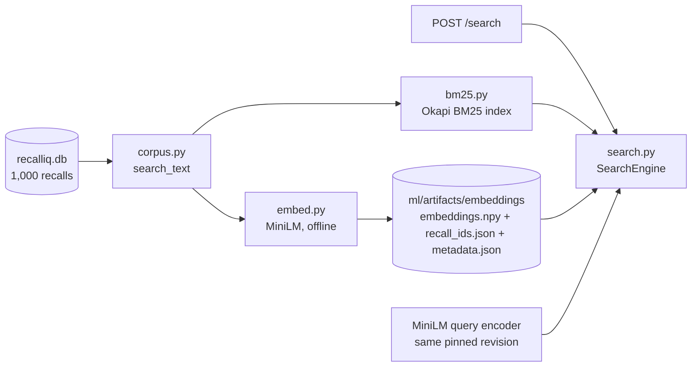

# RecallIQ — Retrieval (Phase 2A: BM25 + pretrained MiniLM)

Code: `ml/retrieval/`. API: `POST /search`. No fine-tuning, no hard negatives, no RAG,
no LLM calls in this phase.



## Corpus and `search_text`
The Phase 2A brief referred to an existing `search_text` field; **no such field existed**
in the Phase 1B database. Rather than change the verified Phase 1B schema, `search_text`
is derived deterministically in `retrieval/corpus.py`:

```
search_text = title [. product] [. issue] [. category]     (missing fields skipped)
```

- Uses verbatim recall fields only.
- **Excludes the heuristic `product_family`**, so unverified labels never influence
  retrieval scores (see *Leakage* below).
- Excludes "What you should do" (mostly empty, otherwise boilerplate).
- `SEARCH_TEXT_VERSION` + a SHA-256 fingerprint of all `(id, search_text)` pairs is stored
  with the embeddings; the server refuses stale embeddings (MiniLM → HTTP 503, BM25 keeps
  working). Unreadable/truncated artifacts, count/dimension mismatches, NaN or non-unit
  rows are treated the same way. A failed model load is cached for 60 s so requests fail
  fast; set `HF_HUB_OFFLINE=1` to forbid network access once the model is cached.

## Models

| | BM25 | MiniLM (pretrained) |
| --- | --- | --- |
| Type | lexical (term overlap) | dense semantic embedding |
| Implementation | `retrieval/bm25.py` (Okapi, k1=1.5, b=0.75, non-negative IDF) | `sentence-transformers/all-MiniLM-L6-v2`, revision pinned to an exact commit |
| Tokenization | NFKC + casefold, `\w+`, tokens > 1 char, 27 English stop-words | model's WordPiece tokenizer |
| Index | built in memory on the first `/search` request, then cached until the DB or embedding metadata changes | precomputed by `python -m retrieval.embed`, 384-d float32, L2-normalized |
| Query cost | scores all docs | encode query (CPU) + one matrix-vector product |
| Returns | only docs with score > 0 (may be fewer than `top_k`) | always `top_k` docs |

## Scores — not comparable across models

| `score_type` | Range | Meaning |
| --- | --- | --- |
| `bm25` | `[0, ∞)` | Sum of IDF-weighted, length-normalized term matches. Depends on corpus statistics and query length; only meaningful for ranking results **of the same query**. |
| `cosine_similarity` | `[-1, 1]` | Angle between query and document embeddings. Not a calibrated probability; absolute values vary by query. |

A BM25 score of 8.2 and a cosine of 0.62 cannot be compared or averaged. Any future hybrid
ranking must normalize or use rank-based fusion (e.g. reciprocal rank fusion) — not done
in this phase.

Ties are broken by smaller recall id, so rankings are deterministic. Every result carries
the original government `recall_id` (NID) and official URL; embedding row *i* maps to
`recall_ids.json[i]`, verified against the database at load time.

## Evaluation status — no accuracy is claimed
- There are **no independent relevance judgments** yet, so no Recall@K / MRR / nDCG is
  reported. `python -m retrieval.smoke` only demonstrates that search runs on real data.
- **No held-out test set exists yet** (Phase 1B created no splits). Nothing in Phase 2A
  tunes parameters on data: BM25 uses textbook defaults, MiniLM is used as published.
  When an evaluation set is built, smoke-test queries must not be reused as test queries.
- The "self-retrieval" test (a record's own `search_text` retrieves itself) is a wiring
  sanity check, not a quality metric.

### Qualitative smoke-test observations (6 queries, not an evaluation)
- **BM25 matches surface tokens.** "my child's hoodie has a drawstring" ranks
  "My First Crayon-Ball" 2nd (token *my*); "baby crib that can collapse" ranks a
  "6 **Can** Mini Fridge" 1st. Stop-words were deliberately **not** tuned to these queries,
  to avoid fitting the system to examples already seen.
- **MiniLM handles paraphrase** in these examples: the hoodie query returns
  drawstring-outerwear recalls; the crib query returns crib recalls.
- Cosine values for the top hit ranged from 0.42 (charger query) to 0.74 (peanut butter
  query) — illustrating that absolute cosine values differ by query and are not a
  relevance threshold.

### Embedding artifacts (verified 2026-11-15)
| Item | Value |
| --- | --- |
| Shape / dtype | (1000, 384) float32, L2 norms 0.99999988 – 1.00000012 |
| `embeddings.npy` size | 1,536,128 bytes (1000 × 384 × 4 + 128-byte header) |
| Model revision | `1110a243fdf4706b3f48f1d95db1a4f5529b4d41` |
| Rebuild | bitwise-identical on re-run in the same environment (Python 3.12.10, torch 2.15.0 CPU, sentence-transformers 6.3.0, same machine); other CPUs/BLAS/torch versions may differ in the last float bits |
| Revision pin | `MINILM_REVISION` in `retrieval/__init__.py` is the `embed` default; the server refuses embeddings whose `model_id` differs or that lack a revision, and encodes queries with the recorded revision |
| Download | ~92 MB of model files (filtered; the unfiltered repo snapshot is ~977 MB) |
| Informal local latency (127.0.0.1, 5 requests, median) | BM25 4.3 ms, MiniLM 15.9 ms after a ~14 s first-request model load |

## Uncertain product families and leakage risk

`python -m recall_data.family_review` exports the 458 flagged records to
`data/processed/family_review.csv` (git-ignored) with empty `reviewer_family`,
`reviewer_notes`, `reviewed_by` columns. **None of these families is verified.**

| Review reason | Records | `product_family` |
| --- | ---: | --- |
| `keyword_match_only` | 235 | one keyword family (medium) |
| `no_keyword_match` | 142 | null (low) |
| `ambiguous_keywords` | 44 | null (low) — several families matched |
| `multiple_official_categories` | 37 | first official category (medium) |
| **Total** | **458** | 388 food, 70 consumer products |

**Informal spot check (assistant's judgment, NOT ground truth; seeded random sample,
2026-11-15):**
- `keyword_match_only`, 25 of 235: 19 looked plausible, 3 debatable (meat lasagna →
  *Meat and poultry*; sweet rice pancake → *Grain products*; vegetable California roll →
  *Fruits and vegetables*), 3 wrong (Date Walnut Loaf → *Nuts*; Strawberry Sundae Cup →
  *Fruits and vegetables*; Blue Marlin & Vegetable Skewers → *Fruits and vegetables*,
  because "marlin" is not a keyword).
- `multiple_official_categories`, 8 of 37: taking the first official category is often
  not the most specific (hair flat iron → *Clothing and accessories*; surf clams →
  *Processed*; stud sensors → *Household items* rather than *Tools*).
- `ambiguous_keywords`, 8 of 44: abstaining looked correct in all 8 (fish cakes, chicken
  rice soup, mixed products). One shows **brand-name leakage**: "Bib's (Wholesale)
  **Meats** brand blue cheese" matched *Meat and poultry* via the brand.

Conclusion: the heuristic families are a useful triage aid but have a visible error
rate even within the plausible-looking "medium" group, so they cannot serve as labels
or relevance judgments without human review.

### Leakage risks for later phases
1. **Label circularity.** Keyword-derived families come from words in the title/product
   text. If they are used as training labels (e.g. positives = same family for
   contrastive fine-tuning), the model can learn the keyword rules themselves, and any
   evaluation that also uses these labels will look better than real retrieval quality.
2. **Unverified labels as ground truth.** 458 of 1,000 selected records are flagged
   `needs_review`. They must not be used as relevance judgments or training targets until
   a human has reviewed them (`reviewer_family` column in the export).
3. **Exact-duplicate titles.** Splits must be made by `title_group` (and ideally by
   brand/product family) so near-identical notices do not appear on both sides of a
   train/test boundary.
4. **Query leakage.** Evaluation queries must be written independently of record text
   and of the smoke-test queries; generating queries from titles and then evaluating on
   those titles measures memorization, not retrieval.

Mitigations already in place: `search_text` excludes `product_family`; every heuristic
family carries `family_source`, `family_confidence`, `needs_review` and `review_reason`.

## Commands
```bash
python -m retrieval.embed                 # compute + save embeddings (downloads model once)
python -m retrieval.smoke                 # realistic consumer queries, both models
python -m recall_data.family_review       # export the needs_review records to CSV
```
